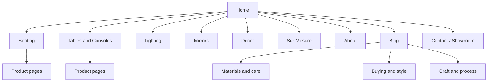

# ATELIER ATLAS — Plan projet (cahier des charges)

> **Source client :** [Moroccan Handmade Furniture Brand — SEO & Content Plan](./cahier-des-charges-seo-content-plan.pdf) (2026-09-17)  
> **Marque provisoire :** ATELIER ATLAS — à remplacer par le nom définitif avant publication.

---

## Executive summary

Lancement d’une marque de **meubles marocains faits main**, niche **design-forward** (travertin, bois massif, métal martelé), positionnée au-dessus des importateurs « Moroccan decor » génériques — **histoire + design**, pas seulement le prix.

**Hypothèses du brief (à confirmer avec le client) :**

1. Contenu **anglais en priorité** (US/UK/EU), même marché que l’activité robinetterie laiton ; **version française plus tard** si la demande EU le justifie.
2. Nom de marque **placeholder** dans tout le contenu jusqu’à validation.

**Opportunité :** aucun des quatre concurrents principaux ne combine le positionnement design de La Marrakechoise avec un **SEO/GEO anglais fort** — c’est l’ouverture.

**Cibles calendaires :**

| Délai | Livrables |
|-------|-----------|
| **30 jours** | Home, Seating, Tables & Consoles, About, Sur-Mesure, Contact |
| **90 jours** | Catégories complètes, **10 articles blog**, schema markup |

---

## Niche & audit concurrentiel

| Site | Positionnement | Prix (indicatif) | Contenu | Gap exploitable |
|------|----------------|------------------|---------|-----------------|
| **lamarrakechoise.com** | Meuble signé, travertin/bois/métal, sur-mesure | 1 600–25 900 MAD | Catalogue, pas de blog ; FR-first | **Lane SEO anglais + blog** |
| **mogadordesign.com** | Sculptural marble/travertin | Entrée ~159–375 USD | Très fin, pas d’About/blog | Out-rank info + brand story |
| **justmorocco.com** | Import US, ornemental/traditionnel | 1 800–19 500+ USD | Listings, pas blog | Ancrage prix, pas modèle contenu |
| **moroccaninterior.com** | Déco/fixtures, fair trade | Mid-range | **Meilleur blog** du groupe | Benchmark cadence blog, pas concurrent meuble direct |

**Synthèse :** combiner **story design** (La Marrakechoise) + **moteur contenu** (Moroccan Interior), en **anglais**, pour leader SEO classique et citations IA sur « Moroccan designer furniture ».

---

## Stratégie mots-clés (SEO + GEO)

**Règle GEO (toutes les pages) :** réponse directe **40–60 mots** en tête, *avant* le storytelling — pour Google AI Mode, Perplexity, ChatGPT/RAG.

| Page | Mot-clé principal | Secondaires | Intent |
|------|-------------------|-------------|--------|
| Home | handmade Moroccan furniture | Moroccan designer furniture, travertine furniture Morocco | Brand + discovery |
| Seating | Moroccan travertine stool / handmade Moroccan chair | sculptural stool, artisan bench Morocco | Commercial |
| Tables & Consoles | Moroccan travertine table | handmade console table Morocco, solid wood console Marrakech | Commercial |
| About | Marrakech furniture workshop | Moroccan artisan furniture maker | Trust / E-E-A-T |
| Sur-Mesure | custom Moroccan furniture | bespoke travertine furniture | Transactionnel |
| Blog (pilier) | Moroccan furniture materials guide | travertine vs marble, how Moroccan furniture is made | Informationnel |
| Contact | Marrakech furniture showroom | Sidi Ghanem furniture atelier | Local / trust |

**Contenu comparaison (priorité GEO) :** « travertine vs marble », « Moroccan vs Scandinavian design » — absent chez les 4 concurrents ; fort pour réponses IA shopping.

### Structure GEO obligatoire

1. Ouverture = **réponse directe** (40–60 mots).
2. **H2/H3 en question** (« Is travertine furniture durable? »).
3. **FAQ** 6–10 Q/R (50–150 mots) + **FAQPage schema** (catégories + blog).
4. **Claims précises** (« 3–6 semaines, 4 artisans ») vs vague (« crafted with passion »).
5. **Bio auteur nommée** (About + chaque article) + lien LinkedIn/Instagram.

---

## Architecture site (sitemap)

- **5 catégories** alignées sur La Marrakechoise : Seating, Tables & Consoles, Lighting, Mirrors, Decor.
- **Priorité rédaction :** Seating + Tables & Consoles (briefs complets dans le PDF).
- **Liens internes :** chaque catégorie/article → Home + **Sur-Mesure** (marge + intent).
- **Breadcrumb schema :** `Home > Category > Product` partout.

---

## Briefs pages (contenu client)

### Home

| SEO | Texte |
|-----|--------|
| **Meta title** (~58 car.) | Handmade Moroccan Furniture in Travertine & Wood \| [Brand] |
| **Meta description** (~150 car.) | Sculptural furniture hand-made in a Marrakech workshop — travertine, solid wood, and hammered metal. Custom sizing available. Ships worldwide. |
| **H1** | Handmade Moroccan Furniture, Shaped by Hand in Marrakech |

**Sections (~1 200 mots cible) :**

- Pourquoi handmade Moroccan furniture (métiers : menuisiers, tailleurs de pierre, dinandiers).
- Matériaux qui vieillissent bien (travertin, bois massif, patine laiton).
- Collection (Seating, Tables & Consoles, Lighting/Mirrors/Decor).
- Sur-mesure + délais made-to-order.
- Visite atelier / showroom → Contact.

**CTAs :** Explore Seating · Explore Tables & Consoles · Start a Custom Order

---

### Seating (catégorie)

| SEO | Texte |
|-----|--------|
| **Meta title** | Handmade Moroccan Seating — Travertine & Wood Stools, Benches, Chairs |
| **Meta description** | Sculptural stools, benches, and chairs hand-shaped in travertine and solid wood in a Marrakech workshop. Made to order, ships worldwide. |

**Opening 40–60 mots (extrait brief) :**  
Handmade Moroccan seating includes travertine stools, solid-wood benches, and upholstered chairs shaped by hand in a Marrakech workshop. Each piece is made to order rather than mass-produced…

**H3 (forme question) :**

- Is travertine comfortable and durable enough for everyday seating?
- Travertine stool vs. solid-wood stool — which to choose?
- Can seating be made to match an existing table or console?
- How much does a custom bench or stool cost? *(fourchette réelle requise)*

**FAQ schema (6) :** poids travertin, outdoor, finition bois, lead time, sets matching, shipping international.

**Liens internes :** Tables & Consoles, Sur-Mesure, futur article entretien travertin/bois.

---

### Tables & Consoles (catégorie)

| SEO | Texte |
|-----|--------|
| **Meta title** | Handmade Moroccan Tables & Consoles — Travertine & Wood |
| **Meta description** | Dining tables, side tables, and console tables combining travertine, solid wood, and hammered metal — hand-made in Marrakech. Custom sizing available. |

**H3 :**

- Is travertine a good material for a dining or console table top?
- Console table vs. side table — what's the difference?
- Can a table be made in a custom size or stone color?
- Do travertine table tops need sealing?

**FAQ schema (6) :** taches, poids, set table+bench, essences bois, lead time custom, shipping gros meubles.

**Liens internes :** Seating, Sur-Mesure, About.

---

### About (E-E-A-T)

**Barre minimale :** égaler La Marrakechoise en anglais (fondateur nommé, citation 1ère personne, métiers artisans).

**À inclure (données réelles client) :**

- Experience : fondateur, années, quartier atelier (Sidi Ghanem / médina).
- Expertise : parcours sketch → matériaux → tailleur / menuisier / dinandier.
- Authoritativeness : nombre d’artisans, ancienneté atelier, presse/salons.
- Trust : adresse = Contact, photos/vidéo atelier, honnêteté sur variations pierre/bois et délais.

**Opening GEO 40–60 mots :** studio + atelier Marrakech, [N] artisans, production to order sans intermédiaire.

**H2 suggérés :** Who designs and makes these pieces / From sketch to finished piece / Why travertine, wood, hammered metal / Visit the workshop

---

### Sur-Mesure (custom)

**Page la plus rentable + intent élevé.**

| SEO | Texte |
|-----|--------|
| **Meta title** | Custom Moroccan Furniture, Made to Your Dimensions \| [Brand] |
| **Meta description** | Design a custom piece with our Marrakech workshop — your dimensions, stone, and finish. First sketch within [X] days. |

**Process (liste numérotée) :** inquiry → first sketch → matériaux/prix → production → shipping.

**Sections :** what can be customized, timeline & pricing ranges réels.

**FAQ (5–6) :** minimum order, match existing piece, shipping international, infos pour devis, sketch avant engagement.

**Conversion :** WhatsApp (comme La Marrakechoise) **+** formulaire email.

---

### Contact / Showroom

| SEO | Texte |
|-----|--------|
| **Meta title** | Visit Our Marrakech Showroom \| [Brand] Contact |
| **Meta description** | Visit the workshop and showroom in Marrakech by appointment, or reach us online for orders, custom quotes, and support. |

**Contenu :** email, WhatsApp, adresse complète, horaires RDV, délai de réponse chiffré.

**Signaux trust :**

- **LocalBusiness schema** (adresse + horaires).
- Lien « Book a visit » / calendrier.
- Contact **trade** (architectes, décorateurs).
- Routing commandes existantes (numéro de commande).

---

## Stratégie blog — 10 premiers articles

**Cadence :** 1/semaine (10 semaines), puis **2/mois** ; refresh stats + « last updated » trimestriel.

**Format article :** 800–1 500 mots ; réponse directe dans les 100 premiers mots ; H2 questions ; 4–6 FAQ + schema ; 1 lien catégorie + 1 lien About ou Sur-Mesure ; byline auteur.

### Pilier 1 — Materials & care

1. Travertine vs. Marble Furniture: What's the Difference?
2. How to Care for a Travertine Table (Sealing, Cleaning, Stains)
3. Is Natural Stone Furniture Durable? What to Know Before You Buy

### Pilier 2 — Buying & style guides

4. How to Choose a Console Table Size for Your Room
5. Moroccan Design Furniture vs. Scandinavian Minimalism: Mixing Styles
6. Travertine Furniture vs. Wood Furniture: Which Fits Your Space?
7. How Much Does Custom Furniture Cost? A Realistic Guide

### Pilier 3 — Craft & process

8. Inside a Marrakech Furniture Workshop: From Sketch to Finished Piece
9. Meet the Artisans: The Carpenters, Stone-Cutters, and Metalworkers Behind [Brand]
10. Why Every Piece Is Made to Order (And Why That Means a Wait)

---

## Checklist GEO (citations ChatGPT & Google AI)

- [ ] Réponse directe en tête sur **chaque** page
- [ ] H2/H3 formulés comme questions utilisateur
- [ ] FAQPage schema (6–10 Q/R) catégories, produits, blog
- [ ] Product schema (matériau, prix, dimensions, dispo)
- [ ] Claims vérifiables (délais, effectifs atelier)
- [ ] Bios auteurs nommées + credentials
- [ ] Dates « last updated » blog ; refresh trimestriel
- [ ] Texte **server-rendered** (pas de SEO caché en JS only)
- [ ] Fichier **`/llms.txt`** (résumés neutres collection + process)
- [ ] Pages comparaison dédiées
- [ ] Ton neutre/déclaratif dans FAQ ; voix marque dans sections story
- [ ] Avis syndiqués (Houzz, Pinterest, Reddit…) + mentions presse tierces
- [ ] Search Console + domaine avant go-live
- [ ] Title + meta **uniques** dès le jour 1

---

## Checklist SEO technique

- [ ] Sitemap XML soumis
- [ ] Breadcrumb schema (catégories + produits)
- [ ] Core Web Vitals (images produit : compression + lazy-load)
- [ ] Alt text descriptif sur chaque visuel
- [ ] HTTPS + mobile dès le lancement
- [ ] Maillage interne : chaque page ↔ au moins 2 autres (About, Blog, Sur-Mesure)

---

## Roadmap (alignée cahier des charges)

| Phase | Timeline | Livrables |
|-------|----------|-----------|
| **1 — Foundation** | Sem. 1–2 | Domaine + nom final, Home live, meta site-wide, Search Console |
| **2 — Core pages** | Sem. 2–4 | Seating, Tables & Consoles, About (noms/photos réels), Sur-Mesure, Contact |
| **3 — Catégories restantes** | Sem. 4–6 | Lighting, Mirrors, Decor (même template) |
| **4 — Blog launch** | Sem. 4–12 | Posts 1–10 à 1/semaine, FAQ schema |
| **5 — GEO hardening** | Sem. 8–14 | llms.txt, pages comparaison, syndication avis, 2–3 mentions presse design |
| **6 — Ongoing** | Mois 4+ | 2 posts/mois, refresh trimestriel, check mensuel citations IA |

### Mesure du succès

- **Google Search Console :** impressions / positions sur la liste mots-clés.
- **Check manuel mensuel :** poser à ChatGPT / Google AI Mode les questions cœur (« best handmade Moroccan furniture brand », « is travertine furniture durable ») et noter si la marque est citée.

---

## Stack technique (projet Next.js)

| Besoin | Outil installé |
|--------|----------------|
| App | Next.js 16, TypeScript, App Router |
| UI | Tailwind CSS v4, shadcn/ui |
| Blog | MDX (`gray-matter`, `next-mdx-remote`) |
| SEO | Metadata API, `next-sitemap`, JSON-LD (`schema-dts`) |
| Formulaires | react-hook-form, zod |
| Email contact | Resend |
| i18n (phase 2) | next-intl |
| Analytics | @vercel/analytics |

Voir [README.md](../README.md) à la racine du repo pour `npm run dev`.

---

## Informations client requises (bloquants)

- [ ] Nom de marque + domaine
- [ ] Fondateur / directeur artistique + citation
- [ ] Adresse showroom + quartier Marrakech
- [ ] Email, WhatsApp, délai de réponse
- [ ] Effectif artisans, délais production
- [ ] Fourchettes prix (collection + sur-mesure)
- [ ] Délai « first sketch » sur-mesure ([X] jours)
- [ ] Photos produits, atelier, portraits artisans
- [ ] Catalogue PDF (optionnel)

---

## Prochaines étapes développement

1. Valider hypothèses (langue, nom marque) avec le client.
2. Layout global (nav catégories, footer trust).
3. Composants réutilisables : `DirectAnswer`, `FAQ` + JSON-LD, fil d’Ariane.
4. Home + **Seating** comme template de référence.
5. Remplir `.env.local` (URL site, Resend, WhatsApp).

---

*Dérivé du cahier des charges client — maintenir ce fichier à jour après chaque validation client.*
